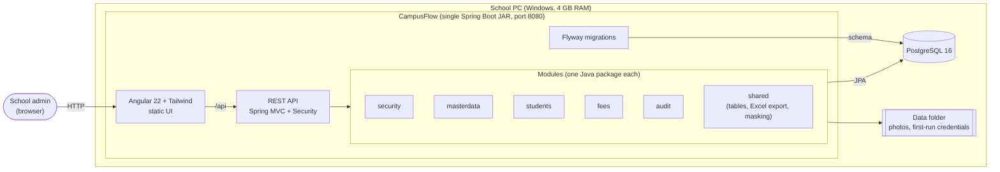
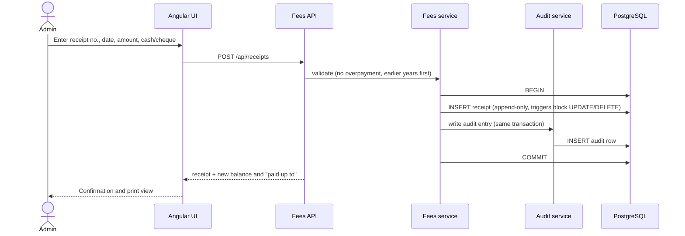
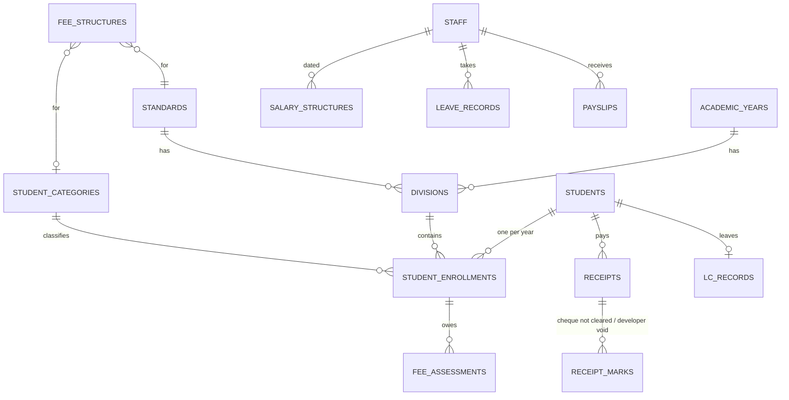
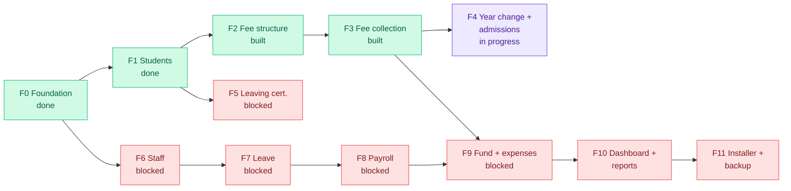
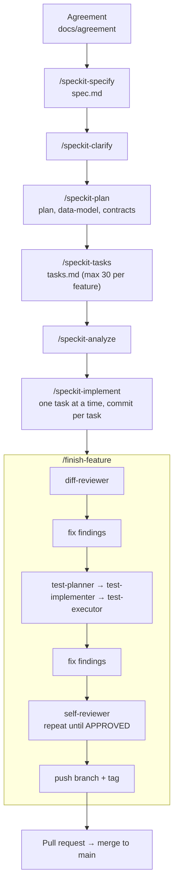

# CampusFlow

**School fees, staff payroll and fund management for Birlasagar Higher Secondary School, Porbandar.**

CampusFlow replaces Excel sheets, receipt books and paper registers with one app that runs on a single school computer. One admin user, PostgreSQL packaged with it, no cloud services required.


---

## Table of contents

1. [What it does](#what-it-does)
2. [Architecture](#architecture)
3. [How the data connects](#how-the-data-connects)
4. [Roadmap and status](#roadmap-and-status)
5. [Quick start](#quick-start)
6. [Testing and verification](#testing-and-verification)
7. [Repository layout](#repository-layout)
8. [Spec-driven workflow](#spec-driven-workflow)
9. [Non-negotiable rules](#non-negotiable-rules)
10. [Deployment](#deployment)
11. [Documentation index](#documentation-index)

---

## What it does

| Module | Highlights |
|---|---|
| **Students and admissions** | Manual registration, Google Form admissions with an approval queue, yearly class record, student profile with photo, duplicate-name warning |
| **Academic year change** | New year by copying last year, promotion wizard, pending fee carried forward |
| **Fees** | Fee structure per standard and category, receipts (number typed from the printed book plus a system serial), partial payments, cash or cheque, "cheque not cleared", "paid up to" date |
| **Leaving certificate** | Issue LC, left-students register, duplicate LC |
| **Staff, leave, payroll** | Staff records, leave balances, monthly payroll that locks when finalised, payslips, Excel salary sheet |
| **Fund, expenses, audit** | Append-only fund ledger, expense tracker, audit log of every financial change |
| **Dashboard and reports** | Graphs with filters, fee and payroll reports, global search, fee reminder notices |

Design principles: nothing financial is ever deleted, every money change is audited, all amounts are exact to the paisa, and a finalised receipt or payroll month is immutable.

---

## Architecture

A modular monolith: one deployable JAR that serves both the REST API and the built Angular UI.



**Stack at a glance**

| Layer | Technology |
|---|---|
| Backend | Java 21, Spring Boot 4.1 (Web MVC, Data JPA, Security, Validation), Flyway, Apache POI (Excel), Maven |
| Frontend | Angular 22, Tailwind CSS 4, plain components, Vitest, Playwright |
| Database | PostgreSQL 16, Flyway-only schema changes, `NUMERIC(12,2)` for money |
| Packaging | Multi-stage Dockerfile (Node 22, JDK 21, JRE 21 Alpine); Render blueprint for demos |

### Request flow: recording a fee receipt



If the audit write fails, the receipt write fails with it.

---

## How the data connects

Core of the model (the full agreement describes 31 tables):



---

## Roadmap and status

Each feature gets its own branch, spec folder and tag. Features F5 to F9 wait on client answers (see `docs/agreement/Client_Questions_*`), so they are not specified yet.



| # | Feature | Spec folder | Status |
|---|---|---|---|
| F0 | Foundation: sign-in, academic years, standards, divisions, categories, audit log, app shell | `specs/001-foundation` | Done |
| F1 | Students and class records | `specs/002-students` | Done |
| F2 | Fee structure and fee accounts | `specs/003-fees` | Built |
| F3 | Fee collection and receipts | `specs/004-fee-collection` | Built |
| F4 | Year change and Google Form admissions | `specs/005-yearchange` | In progress |
| F5 | Leaving certificate | not started | Blocked on client answers |
| F6 to F9 | Staff, leave, payroll, fund and expenses | not started | Blocked on client answers |
| F10 | Dashboard, reports, global search | not started | After data exists |
| F11 | Windows installer, backup and restore | not started | Last |

> The status table reflects `docs/guides/feature-workflow.md` and the spec folders. If it drifts, that guide is the source of truth.

---

## Quick start

### Prerequisites

- JDK **21** (set `JAVA_HOME`)
- Node.js 22 and npm
- Docker (only for the development database)
- Git Bash or PowerShell on Windows

### 1. Start the database

```bash
docker compose -f deploy/docker-compose.yml up -d
```

PostgreSQL listens on `5432`, database `admin_management_db`.

> The compose file is currently commented out. Uncomment it, or point the backend at any PostgreSQL 16 instance.

### 2. Run the backend

```bash
cd management
./mvnw spring-boot:run          # PowerShell: .\mvnw.cmd spring-boot:run
```

On a fresh database the admin password is written to `credentials-first-run.txt` in the data folder (`management/data/`, set by `campusflow.data-dir`). Read it once; the file is deleted when the password is changed. **Never commit it.**

### 3. Run the frontend

```bash
cd frontend
npm install
npm start
```

Open http://localhost:4200. `/api` is proxied to the backend on port 8080.

### Production-style build (UI inside the JAR)

```bash
scripts/build-frontend.sh       # or scripts/build-frontend.ps1
cd management && ./mvnw clean package
java -jar target/*.jar
```

---

## Testing and verification

| What | Command |
|---|---|
| Everything (backend, frontend build and unit tests, browser tests, FR coverage) | `scripts/verify.sh` or `scripts/verify.ps1` |
| Backend build and tests | `cd management && ./mvnw verify` |
| Frontend unit tests | `cd frontend && npm test -- --watch=false` |
| Browser tests (Playwright) | `cd frontend && npm run e2e` |
| Requirement coverage | `scripts/check-fr-coverage.sh --strict` |

Notes:

- Port **8080 must be free** before running `verify` or `e2e`; they start their own backend with the test profile.
- Every functional requirement (`FR-xxx`) needs a test: backend tests use `@Covers("FR-xxx")`, Playwright test titles start with the FR id. The strict coverage check fails if one is missing.
- Tests use synthetic data only.

---

## Repository layout

```
.
├── management/                 Backend: Spring Boot, Java 21, Maven (com.admin.management)
│   ├── src/main/java/…         one package per module: security, masterdata, students, fees, audit, shared
│   ├── src/main/resources/
│   │   └── db/migration/       Flyway SQL migrations (never edit an applied one)
│   └── src/test/java/…         JUnit tests tagged with @Covers("FR-xxx")
├── frontend/                   Angular 22 + Tailwind
│   ├── src/app/{core,features,shared}
│   └── e2e/                    Playwright browser tests
├── specs/                      One folder per feature: spec, plan, tasks, data model, contracts
├── docs/
│   ├── agreement/              Client agreement (source of truth for features and rules)
│   ├── design/                 UI prototype screens and tokens
│   ├── guides/                 Feature workflow guide
│   ├── reports/                Per-feature review and test reports
│   ├── runbooks/               Developer-only production procedures
│   └── decision-log.md         Every decision and open item
├── .specify/                   Spec Kit constitution and templates
├── .claude/                    Claude Code agents, slash commands, hooks, rules
├── scripts/                    verify, build-frontend, FR coverage, seed scripts
├── deploy/                     Docker compose (dev database)
├── Dockerfile                  Multi-stage production image
└── render.yaml                 Render blueprint (demo hosting)
```

---

## Spec-driven workflow

Features are built one at a time with [GitHub Spec Kit](https://github.com/github/spec-kit) and Claude Code. The agreement and spec say **what**, the plan says **how**, tasks say **when**, and code is written last.



Guardrails enforced by hooks in `.claude/hooks`:

- no commit or push on `main`
- no edit of a migration that is already on `main`
- `scripts/verify.sh` plus strict FR coverage must pass before any `git push`
- force-push and `reset --hard` are denied, and `.env`, `backups/` and `real-data/` cannot be read

Start a feature with `/start-feature <short-name>`. See `docs/guides/feature-workflow.md` for the full recipe.

---

## Non-negotiable rules

From `.specify/memory/constitution.md`:

1. **Exact money.** `BigDecimal` in Java, `NUMERIC(12,2)` in the database, never float or double. Rounding is `HALF_UP`, like Excel `ROUND`.
2. **Immutable finalised records.** Receipts and finalised payroll months are never edited or deleted; corrections are reversal entries.
3. **Audited financial writes.** Who, what, when, before and after, in the same transaction.
4. **No hard deletes of people.** Students and staff move to Active/Left status with history.
5. **Flyway-only schema changes.** Applied migrations are never edited.
6. **No real data in the repo.** Synthetic data only; sensitive fields are masked.
7. **Modular monolith.** One package per module, used only through its public API, no cycles, no microservices.

---

## Deployment

| Target | How | Status |
|---|---|---|
| **School PC (production)** | Windows 10, 4 GB RAM, one computer. Single installer bundling Java and PostgreSQL as Windows services, desktop shortcut, daily backup, weekly USB copy | Planned in F11 (no Docker on the school PC) |
| **Demo / staging** | `Dockerfile` plus `render.yaml` on Render with a Neon PostgreSQL database (set `DATABASE_URL`) | Available |

The Docker image caps the JVM at `-Xmx384m` to stay friendly to low-memory machines.

Developer-only operations (correcting a promotion, voiding a receipt, resetting the admin password) are documented in [`docs/runbooks`](docs/runbooks/README.md). They are never available in the UI and require a backup first.

---

## Documentation index

| Document | Purpose |
|---|---|
| [`CLAUDE.md`](CLAUDE.md) | Rules and commands Claude Code reads every session |
| [`docs/agreement/`](docs/agreement/) | Product agreement v1.1 and client questions (English and Gujarati) |
| [`docs/guides/feature-workflow.md`](docs/guides/feature-workflow.md) | How a feature is built, feature list F0 to F11 |
| [`docs/decision-log.md`](docs/decision-log.md) | Decisions and open items |
| [`docs/design/ui-prototype.md`](docs/design/ui-prototype.md) | UI prototype screens and notes |
| [`.specify/memory/constitution.md`](.specify/memory/constitution.md) | Project constitution |
| [`docs/runbooks/`](docs/runbooks/README.md) | Developer-assisted production procedures |

---

## License and ownership

Built for Birlasagar Higher Secondary School, Porbandar. The school's data belongs to the school and its families and is never stored in this repository.
