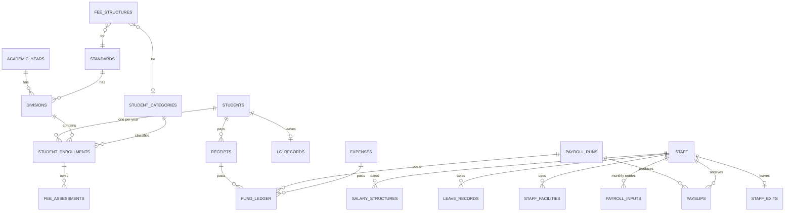

# CampusFlow — Product Agreement

| | |
|---|---|
| **Client** | Birlasagar Higher Secondary School, Porbandar |
| **Version** | 1.1 (decisions of 24 Oct merged, ready for specification) |
| **Date** | 24 Oct 2026 |
| **Academic year in scope** | 2026-27 onward |
| **Sources** | Agreement v0.2 (reviewed HTML), client file `FEE FORMATION.xlsx` (class formation sheet and Oct-26 salary sheet with formulas), receipt book No. 3100 |

This document is the input for the constitution and feature specifications. Business rules that are not written here are defined in the individual feature specs.

---

## 1. Overview

CampusFlow replaces the Excel sheets, receipt books and paper registers used for students, fees, staff, salary and school expenses. It runs on one computer inside the school, with PostgreSQL packaged with it, and needs no cloud services.

**Modules:** Students & Admissions · Academic Year Change · Leaving Certificate · Fees · Staff · Leave · Payroll · Fund, Expenses & Audit · Admin Setup.

**Principles**

- Nothing financial is deleted. A receipt is never cancelled or edited (decided 28-10-2026); the only reversal is marking a cheque as not cleared, with a reason, which adds the amount back to the balance.
- Students and staff who leave move to their own register and disappear from active lists; their history is kept.
- A finalised payroll month is locked. Later rule changes apply only from their effective month.
- All amounts are exact to the paisa (decimal arithmetic, never floating point). Rounding follows section 5.
- Every financial change is written to the audit log.

---

## 2. Users

One person (the school admin) uses the system. There is **no role-based access control**. A single `users` table holds the login; the only role is **Admin**, created by default at installation. Sensitive fields (🔒) are masked on lists and kept out of logs, but no per-role permissions are built.

---

## 3. Features

### Students & Admissions

| ID | Feature | Description |
|---|---|---|
| STU-01 | New registration (manual) | Admin enters student details in the admin tab; GR No. is checked for duplicates. |
| STU-02 | Registration via Google Form | The form response sheet is imported into a waiting list; the admin reviews, corrects and approves each entry. Duplicates are highlighted. |
| STU-03 | Yearly class record | Standard, division, roll no. and category stored for each academic year. |
| STU-04 | Student profile | All details, class history and fee history on one page. |

### Academic Year Change

| ID | Feature | Description |
|---|---|---|
| YR-01 | New academic year setup | Copy standards, divisions and fee structure from last year, then edit. |
| YR-02 | Promotion wizard | Promote a whole class at once; mark detained / left students individually. |
| YR-03 | Pending fee carry-forward | Unpaid fees of last year move to the new year's account, highlighted as brought forward, with a full audit trail. |

### Leaving Certificate (LC)

| ID | Feature | Description |
|---|---|---|
| LC-01 | Issue LC | The admin changes the student's record from Active to Left. The system then prompts a button to prepare the LC. On save, the LC is added to the separate LC table and the LC form is preserved; every LC form stays editable. The LC number follows the LC table. The admin sees a warning if fees are pending; the warning does not block the LC. |
| LC-02 | Left Students Register | A separate list of students who left. The student is removed from the active lists once the LC is saved. |
| LC-03 | Duplicate LC | Reprint, marked as duplicate. |

### Fees

| ID | Feature | Description |
|---|---|---|
| FEE-01 | Fee structure per standard & category | Set in the Admin panel per academic year (amount for each standard and category). |
| FEE-02 | Fee collection & receipt | Receipt for the amount paid, by cash or cheque. Partial payments are allowed. The admin types the receipt number from the school's printed receipt book; the system adds its own serial number. |
| FEE-03 | Paid & pending per student | Always an up-to-date balance. The displayed balance must be consistent with the ledger; because the application is eventually consistent, an inconsistency shows a pop-up with a hard-refresh option. |
| FEE-04 | Cheque not cleared | Receipts cannot be cancelled or edited. If a cheque does not clear, the admin marks the receipt "Cheque not cleared" with a reason; the amount is added back to the balance; audited; the receipt is never deleted. |
| FEE-05 | Due dates | The admin enters the due date in the fee data. There is no late fee. |
| FEE-06 | Fee reminder notices | Printable notice and WhatsApp / SMS draft message, with data grouped per standard. |

### Staff

| ID | Feature | Description |
|---|---|---|
| STF-01 | New staff entry | Admin enters personal, EPF, bank and salary details with an effective month. |
| STF-02 | Salary breakdown | Shows how gross and net are calculated (section 5.2). |
| STF-03 | Staff leaving | Leaving register with settlement details; the staff member is removed from active lists and payroll. |
| STF-04 | Facility charges | Fixed monthly deductions per staff (HR, water, clubs, mess…). |
| STF-05 | **Salary statement for a period (new)** | In a staff profile the admin picks a **From month – To month** and sees the salary received in each month (gross, deductions, net) and the total for the period. Includes an annual total option. Printable and exportable. |

### Leave

| ID | Feature | Description |
|---|---|---|
| LEV-01 | Leave types & allowance | Days allowed per year per type; the leave year runs June to May. |
| LEV-02 | Leave entry | Shows the balance and marks unpaid days automatically. |
| LEV-03 | Unpaid leave in payroll | Unpaid days reduce Paid Days. |
| LEV-04 | Leave encashment | Calculated at leave-year end (ENCHAS column). |

### Payroll

| ID | Feature | Description |
|---|---|---|
| PAY-01 | Monthly payroll | Generate, review and finalise; finalising locks the month. |
| PAY-02 | Payslips | Print / PDF payslip per staff, month-wise. |
| PAY-03 | Salary sheet export | Excel in the school's existing column layout. |
| PAY-04 | Configurable salary rules | Each column's calculation is editable with an effective month (Admin Setup). |

### Fund, Expenses & Audit

| ID | Feature | Description |
|---|---|---|
| FND-01 | Expense tracker | Other school expenses with category, voucher no. and bill photo. |
| FND-02 | Fund ledger | Every rupee in and out in one append-only register, filterable by date, month and year. |
| FND-03 | Monthly carry-forward | Unused balance of the month is carried to the next month. |
| FND-04 | Salary coverage dashboard | How much more money is needed to cover the month's salary and expenses. The salary part is calculated from the salary data entered for the staff (the draft payroll once generated). The exact formula is set in the fund feature spec. |
| FND-05 | Audit log | Who changed what and when, for every financial transaction; filter by date, month, year. |
| FND-06 | Global search | Find any student, staff member, receipt, LC or expense from one search box. |

### Admin Setup & System

| ID | Feature | Description |
|---|---|---|
| ADM-01 | Master data | Academic years, standards, divisions and student categories. |
| ADM-02 | Fee structure entry | Standard-wise and category-wise fee amounts per academic year. |
| ADM-03 | Salary rule editor | Define and change the calculation of each salary column, with an effective month (section 5.2). |
| ADM-04 | Login | Single admin login from the `users` table. |
| ADM-05 | Backup & restore | Automatic daily backup with a documented restore. |
| ADM-06 | Excel import at go-live | Validated import of current students, staff, fee payments and opening balance. |

---

## 4. Data

31 tables. Field types: Text, Number, Amount (₹, exact decimal), Date, Month, Yes / No, Choice, Link (reference to another table). **Required / Optional** is for manual entry; **Auto** means filled by the system. 🔒 = sensitive (masked on lists, kept out of application logs; the audit log stores only a masked value with the last 4 characters visible, and never a password, hash or recovery code).

### 4.1 How the data connects

- A student has one permanent record and one **yearly class record** per academic year, so promotion and history are simple.
- Staff have one permanent record and **dated salary details**; an increment adds a row, so old payslips never change.
- The **fund ledger** is the single audit register for all money; the monthly fund summary and the coverage dashboard are calculated from it.
- A **receipt row never changes** (F3, decided 28-10-2026). Its status is held in a separate append-only mark record (`receipt_marks`): Valid has no mark, Cheque not cleared and Voided by correction each have one. A student's paid and pending amounts are always calculated from the valid receipts.

### 4.2 Setup

#### Academic Years  `academic_years`

Each school year.

| Field | Code | Type | Entry | Notes |
|---|---|---|---|---|
| Year name | `name` | Text | Required | e.g. 2026-27 |
| Start date | `start_date` | Date | Required | e.g. 01-06-2026 |
| End date | `end_date` | Date | Required | e.g. 31-05-2027 |

The current academic year is not stored. It is the year whose start and end dates contain today's date (the school's local date). Years cannot overlap, so at most one year is current; if no year contains today's date there is no current year. A year that is in use cannot be deleted, and academic years have no inactive status.

#### Standards  `standards`

Classes taught in the school.

| Field | Code | Type | Entry | Notes |
|---|---|---|---|---|
| Standard name | `name` | Text | Required | e.g. 1 … 12 |
| Display order | `display_order` | Number | Required |  |
| Stream | `stream` | Choice | Optional | Science / Commerce for 11–12 |
| Active | `active` | Yes / No | Auto | No = hidden from new entries, kept on existing records |

#### Divisions  `divisions`

Divisions of each standard per year.

| Field | Code | Type | Entry | Notes |
|---|---|---|---|---|
| Academic year | `academic_year` | Link | Required |  |
| Standard | `standard` | Link | Required |  |
| Division | `name` | Text | Required | e.g. A, B |
| Active | `active` | Yes / No | Auto | No = hidden from new entries, kept on existing records |

#### Student Categories  `student_categories`

CATEGORY column of class formation sheet. The codes are the school's own; the admin sets the fee for each category in the fee structure.

| Field | Code | Type | Entry | Notes |
|---|---|---|---|---|
| Code | `code` | Text | Required |  |
| Name | `name` | Text | Required | Seed values: O/S, CEW, W, STAFF, S STAFF, RTE, CASUAL (from the class formation sheet) |
| Affects fees | `affects_fees` | Yes / No | Required | Yes = a separate fee amount applies to this category |
| Active | `active` | Yes / No | Auto | No = hidden from new entries, kept on existing records |

#### Fee Structure  `fee_structures`

Amount per standard and category per year.

| Field | Code | Type | Entry | Notes |
|---|---|---|---|---|
| Academic year | `academic_year` | Link | Required |  |
| Standard | `standard` | Link | Required |  |
| Category | `category` | Link | Optional | Blank = all |
| Amount (₹) | `amount` | Amount | Required |  |
| Due date | `due_date` | Date | Optional | Entered by the admin |

#### Users  `users`

People who can log in. Passwords stored encrypted. The default Admin gets a random password at installation, shown once.

| Field | Code | Type | Entry | Notes |
|---|---|---|---|---|
| Full name | `name` | Text | Required |  |
| Username | `username` | Text | Required | Unique |
| Password (hashed) 🔒 | `password_hash` | Text | Required | Stored hashed, never in plain text |
| Role | `role` | Choice | Required | Default and only role: Admin |
| Active | `active` | Yes / No | Auto |  |
| Last login | `last_login` | Date & time | Auto |  |
| Failed sign-ins | `failed_attempts` | Number | Auto | Resets after a successful sign-in |
| Locked until | `locked_until` | Date & time | Auto | Set for 5 minutes after 5 failed sign-ins in a row |
| Password changed | `password_changed` | Yes / No | Auto | No until the admin changes the default password; drives the change-password popup |

### 4.3 Students

#### Students  `students`

Permanent record of each student.

| Field | Code | Type | Entry | Notes |
|---|---|---|---|---|
| GR No. | `gr_no` | Text | Required | Typed by the admin from the school register. Unique, never reused. A student who leaves and returns gets a new GR No. |
| Serial no. | `sr_no` | Number | Auto | System-generated internal serial number, never reused |
| Surname | `surname` | Text | Required |  |
| First name | `first_name` | Text | Required |  |
| Father's / middle name | `middle_name` | Text | Optional |  |
| Gender | `gender` | Choice | Required |  |
| Date of birth | `dob` | Date | Required |  |
| Place of birth | `birth_place` | Text | Optional |  |
| Father's name | `father_name` | Text | Optional |  |
| Mother's name | `mother_name` | Text | Optional |  |
| Mobile 1 | `mobile_1` | Phone | Required | Used for fee reminders |
| Mobile 2 | `mobile_2` | Phone | Optional |  |
| Address | `address` | Text | Required |  |
| Aadhaar number 🔒 | `aadhaar` | Text | Optional | Shown masked |
| Religion / Caste 🔒 | `religion_caste` | Text | Optional | The school needs it; shown masked on lists |
| Category | `category` | Link | Required |  |
| Admission date | `admission_date` | Date | Required |  |
| Admitted in standard | `admission_standard` | Link | Required |  |
| Previous school | `previous_school` | Text | Optional |  |
| Photo | `photo` | Image | Optional | Uploaded by the admin; resized on upload |
| Status | `status` | Choice | Auto | Active / Left |
| Entry source | `source` | Choice | Auto | Manual / Google Form |

#### Yearly Class Record  `student_enrollments`

Replaces the CLASSFORMATION sheet. One row per student per year.

> G.R, NAME, DIV, CATEGORY come from here; R.NO, DATE, PAID FEE, TOTAL, PENDING FEE are calculated from receipts. Roll numbers are given by the class teacher and are not stored.

| Field | Code | Type | Entry | Notes |
|---|---|---|---|---|
| Student | `student` | Link | Required |  |
| Academic year | `academic_year` | Link | Required |  |
| Standard | `standard` | Link | Required |  |
| Division | `division` | Link | Required |  |
| Category (this year) | `category` | Link | Required |  |
| Year status | `status` | Choice | Auto | Studying / Promoted / Detained / Left |

#### Google Form Admissions  `admission_requests`

Waiting list of imported Google Form entries.

| Field | Code | Type | Entry | Notes |
|---|---|---|---|---|
| Submitted on | `submitted_at` | Date & time | Auto |  |
| Form details | `form_data` | All student fields | Auto |  |
| Import batch | `import_batch` | Number | Auto |  |
| Possible duplicate | `duplicate_flag` | Yes / No | Auto | Same name + DOB + mobile |
| Review status | `status` | Choice | Auto | Pending / Approved / Rejected |
| Reviewed by | `reviewed_by` | Link | Auto |  |
| Remarks | `remarks` | Text | Optional |  |

#### Left Students Register (LC)  `lc_records`

Students who left; removed from active lists.

| Field | Code | Type | Entry | Notes |
|---|---|---|---|---|
| LC No. | `lc_no` | Text | Auto | Auto-numbered |
| Student (GR No.) | `student` | Link | Required |  |
| Date of leaving | `leaving_date` | Date | Required |  |
| Date of issue | `issue_date` | Date | Required |  |
| Std & division at leaving | `last_class` | Auto | Auto |  |
| Reason for leaving | `reason` | Text | Required |  |
| Conduct | `conduct` | Text | Required | e.g. Good; as written on the school's LC form |
| Progress / last result | `progress` | Text | Optional |  |
| Fees cleared | `fees_cleared` | Yes / No | Auto | Warning only; does not block the LC |
| Duplicate LC issued | `duplicate_count` | Number | Auto |  |
| Issued by | `issued_by` | Link | Auto |  |
| LC form (saved copy) | `form_copy` | Document | Auto | The generated LC form is preserved and stays editable (LC-01) |

### 4.4 Fees

#### Student Fee Account  `fee_assessments`

What each student must pay in a year: one row for the year's fee and one brought-forward row for dues of earlier years.

| Field | Code | Type | Entry | Notes |
|---|---|---|---|---|
| Yearly class record | `enrollment` | Link | Required |  |
| Amount (from structure) | `amount` | Amount | Auto |  |
| Due date | `due_date` | Date | Optional |  |
| Brought forward | `carried_forward` | Yes / No | Auto | From previous year |

#### Receipts  `receipts`

Every fee receipt, matching the receipt book.

| Field | Code | Type | Entry | Notes |
|---|---|---|---|---|
| Receipt No. | `receipt_no` | Number | Required | Typed by the admin from the printed receipt book, e.g. 3100; duplicates are flagged |
| Serial no. | `serial_no` | Number | Auto | The system's own running number; never reused |
| Receipt date | `receipt_date` | Date | Required |  |
| Academic year | `academic_year` | Link | Auto |  |
| Received from (student) | `student` | Link | Required |  |
| Std / Division | `class_snapshot` | Auto | Auto | Standard and division copied at the time of receipt |
| Payment mode | `payment_mode` | Choice | Required | Cash / Cheque |
| Cheque no. | `cheque_no` | Text | Optional |  |
| Cheque dated | `cheque_date` | Date | Optional |  |
| Bank name | `bank_name` | Text | Optional |  |
| Total (₹) | `total` | Amount | Auto |  |
| Total in words | `total_words` | Text | Auto |  |
| Receipt type | `receipt_type` | Choice | Auto | Current year (registration fee row + year fee row) / Previous years' pending (for one earlier academic year) |
| Registration fee paid (₹) | `registration_paid` | Amount | Optional | Separate row on the receipt; current-year receipts only |
| Year fee paid (₹) | `fee_paid` | Amount | Optional | Separate row on the receipt |
| Paid up to | `paid_up_to` | Date | Auto | **F3 change:** not stored on the receipt and not printed. Calculated from the valid year-fee payments (last paid day, rounded half up) and shown on the student profile and the Students list |
| Status | `status` | Choice | Auto | **F3 change:** Valid / Cheque not cleared / Voided by correction, held as a mark in `receipt_marks`, never as a change to the receipt |
| Not-cleared reason | `unclear_reason` | Text | Optional | **F3 change:** held in the mark record; required when marked; marked by and on are audited |
| Received by | `created_by` | Link | Auto |  |

#### Fee Reminders  `fee_reminders`

Every reminder generated.

| Field | Code | Type | Entry | Notes |
|---|---|---|---|---|
| Generated on | `created_at` | Date | Auto |  |
| Student | `student` | Link | Required |  |
| Pending amount (₹) | `pending_amount` | Amount | Auto |  |
| Type | `channel` | Choice | Required | Notice / WhatsApp / SMS |
| Message text | `message` | Text | Auto |  |
| Generated by | `created_by` | Link | Auto |  |

### 4.5 Staff

#### Staff  `staff`

Permanent record of each staff member.

| Field | Code | Type | Entry | Notes |
|---|---|---|---|---|
| Employee code | `emp_code` | Text | Auto |  |
| Title | `title` | Choice | Required | Mr. / Ms. / Mrs. |
| Full name | `name` | Text | Required |  |
| Designation | `designation` | Text | Required |  |
| Staff type | `staff_type` | Choice | Required | Teaching / Non-teaching |
| Gender | `gender` | Choice | Required |  |
| Date of birth | `dob` | Date | Required |  |
| Date of joining | `joining_date` | Date | Required |  |
| Mobile | `mobile` | Phone | Required |  |
| Address | `address` | Text | Optional |  |
| EPF No. 🔒 | `epf_no` | Text | Optional |  |
| UAN 🔒 | `uan` | Text | Optional |  |
| PAN 🔒 | `pan` | Text | Optional |  |
| Bank account no. 🔒 | `bank_ac` | Text | Required | Shown masked |
| Bank name & IFSC | `bank_ifsc` | Text | Optional |  |
| Status | `status` | Choice | Auto | Active / Left |

#### Salary Details  `salary_structures`

Fixed salary values with effective month.

| Field | Code | Type | Entry | Notes |
|---|---|---|---|---|
| Staff | `staff` | Link | Required |  |
| Effective from | `effective_from` | Month | Required |  |
| Confirmed staff | `is_confirmed` | Yes / No | Required | Yes: salary = Basic + DA. No: salary = Consolidated salary |
| Basic (₹) 🔒 | `basic` | Amount | Required |  |
| DA % | `da_percent` | Percent | Required | Default 257% |
| Consolidated salary (₹) 🔒 | `con_salary` | Amount | Optional | Used for non-confirmed staff (replaces Basic + DA) |
| Conveyance (₹) | `conveyance` | Amount | Optional |  |
| Special allowance (₹) | `special_allowance` | Amount | Optional |  |
| Medical allowance (₹) | `medical` | Amount | Optional |  |
| LTA (₹) | `lta` | Amount | Optional |  |
| CBSE TR (₹) | `cbse_tr` | Amount | Optional | Monthly CBSE TR amount (sheet column "CBSE TR") |
| EPF applicable | `epf_applicable` | Yes / No | Required | No = EPF columns are zero |
| LIC premium (₹) | `lic` | Amount | Optional |  |
| Gratuity applicable | `gratuity_applicable` | Yes / No | Required |  |

#### Salary Rules  `salary_components`

Every salary-sheet column and its calculation (section 5.2).

| Field | Code | Type | Entry | Notes |
|---|---|---|---|---|
| Column name | `label` | Text | Required |  |
| Code | `code` | Text | Required |  |
| Type | `kind` | Choice | Required | Earning / Deduction / Employer / Info |
| Calculation method | `method` | Choice | Required | Fixed / % / Paid days / Slab / Monthly / Special |
| Based on | `base` | Columns | Optional |  |
| Rate / % | `rate` | Number | Optional |  |
| Effective from | `effective_from` | Month | Required |  |
| Rounding | `rounding` | Choice | Required |  |
| Show on payslip | `on_payslip` | Yes / No | Required |  |
| Show on salary sheet | `on_sheet` | Yes / No | Required |  |
| Order | `display_order` | Number | Required |  |

#### Staff Leaving Register  `staff_exits`

Staff who left; removed from active lists and payroll.

| Field | Code | Type | Entry | Notes |
|---|---|---|---|---|
| Staff | `staff` | Link | Required |  |
| Last working day | `last_working_day` | Date | Required |  |
| Reason | `reason` | Choice | Required | Resigned / Retired / Terminated / Other |
| Notice date | `notice_date` | Date | Optional |  |
| Final settlement (₹) 🔒 | `final_settlement` | Amount | Optional |  |
| Gratuity paid (₹) 🔒 | `gratuity_paid` | Amount | Optional |  |
| Leave encashment (₹) | `leave_encashment` | Amount | Optional |  |
| Experience certificate | `exp_cert` | Yes / No | Optional |  |
| Remarks | `remarks` | Text | Optional |  |

#### Leave Types  `leave_types`

Kinds of leave and days allowed.

| Field | Code | Type | Entry | Notes |
|---|---|---|---|---|
| Leave name | `name` | Text | Required | e.g. CL, ML, EL |
| Days allowed per year | `days_per_year` | Number | Required |  |
| Paid leave | `paid` | Yes / No | Required |  |
| Carry forward | `carry_forward` | Yes / No | Required |  |
| Encashable | `encashable` | Yes / No | Required | ENCHAS column |
| Leave year | `leave_year` | Text | Required | Jun to May |

#### Leave Records  `leave_records`

Each leave taken.

| Field | Code | Type | Entry | Notes |
|---|---|---|---|---|
| Staff | `staff` | Link | Required |  |
| Leave type | `leave_type` | Link | Required |  |
| From date | `from_date` | Date | Required |  |
| To date | `to_date` | Date | Required |  |
| Days | `days` | Number | Auto |  |
| Paid / Unpaid | `paid` | Auto | Auto |  |
| Reason | `reason` | Text | Optional |  |
| Approved by | `approved_by` | Text | Optional |  |

#### Leave Balance  `leave_balances`

Calculated view.

| Field | Code | Type | Entry | Notes |
|---|---|---|---|---|
| Staff | `staff` | Link | Auto |  |
| Leave year | `leave_year` | Text | Auto |  |
| Leave type | `leave_type` | Link | Auto |  |
| Allowed / Taken / Balance | `balance` | Numbers | Auto |  |
| Unpaid days this month | `unpaid_days` | Number | Auto |  |

#### Facilities & Deductions  `facilities`

Facilities whose charges are deducted from salary. All are fixed monthly amounts.

| Field | Code | Type | Entry | Notes |
|---|---|---|---|---|
| Name | `name` | Text | Required | Seed values: HR, FR, Water, TVC, Gents Club, Ladies Club, HOLI, SMC, Club, S.Mess, Staff Club, Staff Tea Club, CBSE TR (deduction), School Fees, GRA. |
| Default amount (₹) | `default_amount` | Amount | Optional |  |

#### Facility Subscriptions  `staff_facilities`

Which staff uses which facility.

| Field | Code | Type | Entry | Notes |
|---|---|---|---|---|
| Staff | `staff` | Link | Required |  |
| Facility | `facility` | Link | Required |  |
| Monthly amount (₹) | `amount` | Amount | Optional |  |
| From month | `from_month` | Month | Required |  |
| To month | `to_month` | Month | Optional |  |

#### Monthly Salary Entries  `payroll_inputs`

Amounts the admin enters for one staff member for one month, before the payroll is generated.

| Field | Code | Type | Entry | Notes |
|---|---|---|---|---|
| Month | `month` | Month | Required |  |
| Staff | `staff` | Link | Required |  |
| Arrears (ARR.) 🔒 | `arr` | Amount | Optional | Added to earnings; EPF on arrears is calculated from it |
| Unpaid net arrears 🔒 | `unpaid_net_arr` | Amount | Optional | UNPAID NET ARR column |
| Leave encashment | `encashment` | Amount | Optional | ENCHAS column (LEV-04) |
| Income tax (₹) 🔒 | `income_tax` | Amount | Optional | Entered each month |
| Entered by | `created_by` | Link | Auto |  |

### 4.6 Payroll

#### Payroll Months  `payroll_runs`

One row per salary month: Draft → Checked → Finalised (locks the month).

| Field | Code | Type | Entry | Notes |
|---|---|---|---|---|
| Month | `month` | Month | Required | e.g. OCT-26 |
| Monthly days | `monthly_days` | Number | Required | Days in the month (31 for Oct-26 in the school sheet) |
| Status | `status` | Choice | Auto | Draft / Checked / Finalised |
| Totals | `totals` | Amount | Auto |  |
| Gratuity total | `gratuity_total` | Amount | Auto |  |
| Prepared by | `prepared_by` | Link | Auto |  |
| Finalised by & on | `finalised_by` | Link | Auto |  |

#### Payslips  `payslips`

One per staff per month; never changes once finalised. Also the source of the salary statement for a period (STF-05).

| Field | Code | Type | Entry | Notes |
|---|---|---|---|---|
| Payroll month | `payroll_run` | Link | Required |  |
| Staff details (copy) 🔒 | `staff_snapshot` | Auto | Auto |  |
| Monthly / Paid days | `days` | Number | Auto |  |
| Unpaid days | `unpaid_days` | Number | Auto |  |
| EPF wages | `epf_wages` | Amount | Auto |  |
| All salary columns 🔒 | `lines` | Amounts | Auto | One value per Salary Rule (section 5.2) |
| Total salary 🔒 | `gross` | Amount | Auto |  |
| Total deduction 🔒 | `total_deduction` | Amount | Auto |  |
| Net payment 🔒 | `net` | Amount | Auto |  |
| Gratuity 4.81% | `gratuity` | Amount | Auto |  |

### 4.7 Finance

#### Fund Ledger  `fund_ledger`

Audit register of all money in and out. Never edited; corrections are new entries.

| Field | Code | Type | Entry | Notes |
|---|---|---|---|---|
| Entry no. | `entry_no` | Number | Auto |  |
| Date | `txn_date` | Date | Required |  |
| Month | `month` | Month | Auto |  |
| Entry type | `type` | Choice | Required | Opening / Fee / Cancel / Salary / Expense / Cash added / Adjustment |
| In / Out | `direction` | Choice | Auto |  |
| Amount (₹) | `amount` | Amount | Required |  |
| Linked record | `reference` | Link | Optional |  |
| Description | `description` | Text | Required |  |
| Entered by & at | `created_by` | Link | Auto |  |

#### Expense Categories  `expense_categories`

Groups for school expenses.

| Field | Code | Type | Entry | Notes |
|---|---|---|---|---|
| Name | `name` | Text | Required | List to confirm |
| Description | `description` | Text | Optional |  |
| Active | `active` | Yes / No | Auto |  |

#### Expenses  `expenses`

Other school expenses.

| Field | Code | Type | Entry | Notes |
|---|---|---|---|---|
| Date | `expense_date` | Date | Required |  |
| Category | `category` | Link | Required |  |
| Paid to | `payee` | Text | Required |  |
| Description | `description` | Text | Required |  |
| Amount (₹) | `amount` | Amount | Required |  |
| Payment mode | `payment_mode` | Choice | Required | Cash / Cheque / Bank |
| Bill / voucher no. | `voucher_no` | Text | Optional |  |
| Bill photo / PDF | `attachment` | File | Optional |  |
| Status | `status` | Choice | Auto | Recorded / Cancelled |
| Entered by | `created_by` | Link | Auto |  |

#### Monthly Fund Summary  `monthly_fund_summary`

Calculated from the fund ledger.

| Field | Code | Type | Entry | Notes |
|---|---|---|---|---|
| Month | `month` | Month | Auto |  |
| Opening balance | `opening` | Amount | Auto | Carried from last month |
| Fees collected | `fees_in` | Amount | Auto |  |
| Other money added | `other_in` | Amount | Auto |  |
| Salary payable | `salary_out` | Amount | Auto |  |
| Expenses | `expense_out` | Amount | Auto |  |
| Closing balance | `closing` | Amount | Auto |  |
| Shortfall / surplus | `coverage` | Amount | Auto | Amount needed to cover the month, calculated from the salary data entered (FND-04); formula in the fund feature spec |

### 4.8 System

#### Audit Log  `audit_log`

Automatic record of every change.

| Field | Code | Type | Entry | Notes |
|---|---|---|---|---|
| Date & time | `at` | Date & time | Auto |  |
| User | `user` | Link | Auto |  |
| Area | `area` | Choice | Auto | Security / Master data / Students / Fees / Payroll / Fund |
| Action | `action` | Choice | Auto | Create / Edit / Delete / Cancel / Finalise / Login / Import / Export |
| Record type & ID | `entity` | Text | Auto |  |
| Old / New value | `changes` | Text | Auto | Fields marked 🔒 are stored masked (last 4 characters visible). Password and password hash are never stored; the entry only says the field changed |
| Reason | `reason` | Text | Optional | Required for cancellations |

#### Backup History  `backup_history`

Shows that backups are happening.

| Field | Code | Type | Entry | Notes |
|---|---|---|---|---|
| Time | `at` | Date & time | Auto |  |
| File name & size | `file` | Text | Auto |  |
| Status | `status` | Choice | Auto | Success / Failed |
| Copied to USB / Drive | `copied_offsite` | Yes / No | Optional |  |

---

## 5. Calculation rules

These come from the school's own Excel formulas (`FEE FORMATION.xlsx`). Amounts use the same rounding as Excel `ROUND(x, 0)`: nearest rupee, halves rounded up.

### 5.1 Class formation and fees

Replaces the CLASSFORMATION sheet (year 2026-27). Sheet columns map as follows:

| Sheet column | In CampusFlow |
|---|---|
| G.R | Student GR No. |
| S.NO | Roll / serial no. (yearly class record) |
| NAME OF STUDENT | Student name |
| DIV. | Division (yearly class record) |
| CATEGORY | Student category: O/S, CEW, W, STAFF, S STAFF, RTE, CASUAL |
| R.NO. | Receipt no. of the payment |
| DATE | Receipt date |
| PAID FEE | Sum of valid receipts for the year |
| TOTAL | Net payable for the year (fee structure amount for the standard and category) |
| PENDING FEE | TOTAL − PAID FEE |

- Fee structure: one amount per **(academic year, standard, category)**.
- Pending fee = Net payable − sum of valid (non-cancelled) receipts. Cancelled receipts are excluded and reversed in the fund ledger.
- Unpaid fee of a closed year is carried into the new year as "brought forward".

### 5.2 Salary

**Inputs per month:** Monthly days (days in the month), Paid days (Monthly days − unpaid leave days), the staff's salary details, facility subscriptions, and the monthly entries (arrears, unpaid net arrears, leave encashment, income tax).

**Formulas** (as in the school sheet):

| Step | Column | Calculation |
|---|---|---|
| 1 | D.A. | `ROUND(Basic × 257%, 0)` (rate editable with an effective month) |
| 2 | TOTAL Salary | `Basic + D.A.` |
| 3 | Salary base | Confirmed staff: `TOTAL Salary`. Non-confirmed staff: `Con Salary` (consolidated amount) |
| 4 | E.P.F. Wages | `ROUND(Salary base ÷ Monthly days × Paid days, 0)`. **No wage ceiling** is applied. |
| 5 | Total (earnings payable) | `E.P.F. Wages + ARR + Conveyance + Spl. All + CBSE TR + ENCHAS + Medical + LTA + UNPAID NET ARR` |
| 6 | E.P.F. 12% | `ROUND(E.P.F. Wages × 12%, 0)` |
| 7 | EPF Vol. | Equal to E.P.F. 12% |
| 8 | EPF (arrears) | `ROUND(ARR × 12%, 0)` |
| 9 | VOL.EPF (arrears) | Equal to EPF (arrears) |
| 10 | P.T. | `200` if E.P.F. Wages ≥ 12,000, otherwise `0` |
| 11 | Income Tax | Entered by the admin each month |
| 12 | EDUC 4% Sc. | `ROUND(Income Tax × 4%, 0)` |
| 13 | Other deductions | L.I.C., HR, FR, Water, Tvc, Gents Club, Ladies Club, HOLI, SMC, Club, S.Mess, CBSE TR., SCHOOL FEES, GRA., Staff Club, Staff Tea Club: fixed monthly amounts set per staff |
| 14 | Total Deduction | Sum of columns 6 to 13 (E.P.F. 12% through Staff Tea Club) |
| 15 | Net Payment | `Total (step 5) − Total Deduction` |
| 16 | Gratuity 4.81% | `ROUND(E.P.F. Wages × 4.81%, 0)`. Employer provision, **not** deducted from the staff. |

If EPF is not applicable for a staff member, steps 6 to 9 are 0. Gratuity (step 16) is calculated only when gratuity is applicable.

Conveyance, Spl. All, CBSE TR, ENCHAS, Medical and LTA are added as entered; they are **not** prorated by paid days. Only the salary base (step 4) is prorated.

**Reference case from the school sheet** (Oct-26, one staff member, name and account number left out; the sheet's electricity column is not carried into CampusFlow; it was 0 here):

| Column | Value |
|---|---|
| Basic | 22,888 |
| D.A. (257%) | 58,822 |
| TOTAL Salary / E.P.F. Wages (31 of 31 days) | 81,710 |
| E.P.F. 12% and EPF Vol. | 9,805 + 9,805 |
| P.T. | 200 |
| L.I.C. | 2,622 |
| HR / FR / Water | 10 / 3 / 7 |
| Gents Club / Staff Club / Staff Tea Club | 135 / 25 / 40 |
| Total Deduction | 22,652 |
| Net Payment | 59,058 |
| Gratuity 4.81% | 3,930 |

### 5.3 Salary sheet column mapping

| Sheet column | Code | Type | Source / calculation |
|---|---|---|---|
| Sr.No. |  | Info | Row number, automatic |
| Name |  | Info | Staff record |
| DESIG. |  | Info | Staff record |
| Basic | `BASIC` | Earning | Salary details |
| D.A. 257% | `DA` | Earning | Step 1 |
| TOTAL Salary | `TOTAL` | Total | Step 2 |
| Con Salary | `CON` | Earning | Salary details (non-confirmed staff) |
| Monthly days | `MD` | Info | Days in the month |
| Paid Days | `PD` | Info | Monthly days − unpaid leave days |
| E.P.F Wages | `EPFW` | Info | Step 4 |
| ARR. | `ARR` | Earning | Monthly entry |
| Conveyance | `CONV` | Earning | Salary details, as entered |
| Spl.all | `SPL` | Earning | Salary details, as entered |
| CBSE TR | `CBSETR` | Earning | Salary details, as entered |
| ENCHAS | `ENCH` | Earning | Leave encashment, monthly entry |
| Medical | `MED` | Earning | Salary details, as entered |
| LTA | `LTA` | Earning | Salary details, as entered |
| UNPAID NET ARR | `UNPAID` | Earning | Monthly entry (adjustment) |
| Total | `GROSS` | Total | Step 5 |
| E.P.F. 12% | `EPF` | Deduction | Step 6 |
| EPF Vol. | `EPFV` | Deduction | Step 7 |
| EPF (arrears) | `EPFA` | Deduction | Step 8 |
| VOL.EPF (arrears) | `EPFAV` | Deduction | Step 9 |
| P.T. | `PT` | Deduction | Step 10 |
| Income Tax | `IT` | Deduction | Monthly entry |
| EDUC 4% Sc. | `EDUC` | Deduction | Step 12 |
| L.I.C. | `LIC` | Deduction | Salary details |
| HR, FR, Water, Tvc, Gents Club, Ladies Club, HOLI, SMC, Club, S.Mess, Staff Club, Staff Tea Club |  | Deduction | Facility subscriptions (fixed monthly) |
| CBSE TR. |  | Deduction | Facility subscription (fixed monthly) |
| SCHOOL FEES |  | Deduction | Facility subscription (fixed monthly) |
| GRA. |  | Deduction | Facility subscription (fixed monthly) |
| Total Deduction | `DEDUCT` | Total | Step 14 |
| Net Payment | `NET` | Total | Step 15 |
| Bank A/C |  | Info | Staff record 🔒 |
| 4.81% Gratuity | `GRAT` | Employer | Step 16 |

Each row becomes a **salary rule** (table `salary_components`) editable in Admin Setup, with an effective month. Finalised months store every computed value and are never recalculated.

---

## 6. Workflows

**New admission (office)**  
Open New Student → Enter details → System checks GR No. and duplicates → Save → Create class record → Fee account created

**Admission via Google Form**  
Student fills Google Form → Admin clicks Import → Waiting list → Duplicates highlighted → Review and approve → Becomes student with class record

**Fee collection**  
Search student → See pending balance → Enter receipt no. from the book, amount and cash / cheque details → Save (system adds a serial no.) → Print receipt → Fund ledger updated

**Cheque not cleared**  
Open cheque receipt → Mark "Cheque not cleared" with reason → Amount added back to the balance and "paid up to" recalculated → Audit log (fund ledger reversal when F9 exists)

**Fee reminders**  
Fee dashboard → Filter pending by standard → Select students → Generate notice / message → Print or copy to send

**Academic year change**  
Create new year → Copy setup → Edit fees → Promotion wizard → Mark detained / left → Carry forward dues → Close old year

**Student leaving (LC)**  
Open student → Mark as Left → Prepare LC (warning if fees are pending) → Save LC (stored in LC table, form preserved) → Print → Removed from active lists

**New staff**  
Enter details → Salary details with effective month → Facilities → Leave balance created → Included in next payroll

**Monthly payroll**  
Enter leaves and monthly salary entries → Generate draft → Review → Mark checked → Finalise (locks month) → Print payslips → Ledger: salary out

**Staff salary statement**  
Open staff profile → Choose From month – To month → View monthly salary and total → Print / export

**Staff leaving**  
Open staff → Leaving details → Settlement → Leaving register → Removed from payroll

**Monthly fund and expenses**  
Record expenses → Fees flow in → Dashboard shows coverage → Add cash if shortfall → Month-end carry forward

---

## 7. Dashboards

Every list screen has a search box, filters on any column, sorting and export to Excel. Lists are paged on the server.

| Dashboard | What it shows |
|---|---|
| Students | Search by name, GR No., mobile. Filter by year, standard, division, category, status, fees pending. |
| Staff | Filter by designation, type, status. Salary, leave balance, facilities per staff; salary statement for a period. |
| Fee Tracker | Per standard: due, collected, pending, % collected. Drill down to the student. |
| Receipts / Invoices | Filter by date, payment mode, standard, status. Day-wise totals. Reprint. |
| Fund & Salary Coverage | Opening balance, fees collected, salary needed, expenses, shortfall / surplus. Month, date range and yearly views. |
| Expenses | By category, month and year. |
| Leave | Who is on leave, balances, unpaid days. |
| Payroll | Month-wise totals, per-staff breakdown, comparison with last month. |
| Global Search | Students, staff, receipts, LC numbers and expenses. |

---

## 8. Printable documents

| Document | Notes |
|---|---|
| Fee receipt | Layout follows the school's receipt book (receipt no. typed by the admin, date, cheque no. and date, received from, standard, division, amount, amount in words). F3 change: every print is identical; there is no DUPLICATE mark and prints are not recorded. |
| Payslip | Month-wise, as in the school's sample, with deductions, net payment and leave balance. |
| Leaving Certificate | Generated on save, preserved and editable. Reprints are marked duplicate. |
| Fee reminder notice | Printable letter and WhatsApp / SMS text, grouped per standard. |
| Salary sheet | Excel export in the school's existing column layout. |
| Salary statement | Period statement for a staff member (STF-05). |
| Reports | Class formation sheet, pending fee list, day-wise collection, monthly fund summary, expense and leave reports. Excel and PDF. |

---

## 9. Installation, updates and data safety

- **Installation:** the application and PostgreSQL are installed together on one school computer, with a desktop shortcut. Docker deployment, no cloud.
- **Updates:** one update package. It takes a backup first, then updates; if it fails, the previous version is restored.
- **Backups:** automatic daily backup (last 7 days, 4 weeks and 12 months kept). The dashboard shows the last backup time. A copy to USB or Drive is reminded weekly.
- **Privacy:** data stays inside the school. Sensitive fields are masked and kept out of logs.
- **Growth:** server-side paging and indexes keep the system fast on a normal PC for many years of data.

---

## 10. Assumptions and out of scope

**Assumptions**

- One school, one campus, one admin user.
- The system runs on one computer in the school; other computers can open it in a browser over the school network.
- Internet is needed only for importing Google Form entries.
- Current students, staff, this year's payments and the opening balance are imported from Excel at go-live.
- For 1–2 months after go-live, Excel and CampusFlow run side by side and the totals are compared.

**Out of scope for version 1**

- Role-based access control and multiple users.
- Online fee payment by parents.
- Automatic sending of SMS / WhatsApp (the system prepares the message).
- Attendance, exams and marks, timetable, library, transport.
- Parent or student login, mobile app.
- Government portal uploads (EPF ECR, income tax returns).
- Cloud hosting.
- Late fees, fee concessions, caution money and monthly-varying salary deductions such as electricity.

**Defined in the feature specs:** leave types and encashment details (from the client's answers); the fund coverage formula (from the salary data entered); Gujarati / English wording of notices.

---

## 11. Decision log

| Date | Decision |
|---|---|
| 24-10-2026 | v0.1 draft shared for review. |
| 24-10-2026 | v0.2 reviewed. Single admin user; no access control. The `users` table is kept, with Admin as the only role. |
| 24-10-2026 | Fee heads and receipt lines removed. A fee is one amount per (year, standard, category) and a receipt records the total paid. |
| 24-10-2026 | Fields with an empty or "NA" name removed: Academic Years → `status`; Standards → `next_standard`; Divisions → `section`; Divisions → `class_teacher`; Student Categories → `description`; NOT REQ (table) → `fee_heads`; Fee Structure → `fee_head`; Left Students Register (LC) → `conduct`; Left Students Register (LC) → `caution_refund`; Student Fee Account → `fee_head`; Student Fee Account → `concession`; Student Fee Account → `concession_reason`; NA (table) → `receipt_items`. |
| 24-10-2026 | Questions section removed; the answers are written in the feature specs. |
| 24-10-2026 | Salary rules filled from the client's Excel formulas. EPF has no wage ceiling; the extra EPF columns equal the EPF amounts; P.T. is 200 from wages of 12,000. |
| 24-10-2026 | New feature STF-05: salary received for a chosen period in the staff profile, with an annual total option. |
| 24-10-2026 | Added to support agreed features: `password_hash` (users), `form_copy` (LC records), `is_confirmed` (salary details). |
| 24-10-2026 | v1.1. No late fee; the admin enters due dates in the fee data. `late_fee_rule` removed. |
| 24-10-2026 | No fee concessions and no caution money. `net_amount` removed from the fee account. The LC shows a warning only when fees are pending; it does not block the LC. |
| 24-10-2026 | Receipt number is typed by the admin from the printed receipt book; the system adds its own serial number (`serial_no`). |
| 24-10-2026 | `conduct` added back to the LC record. |
| 24-10-2026 | FND-04 coverage is calculated from the salary data entered; the exact formula is set in the fund feature spec. |
| 24-10-2026 | Category codes are the school's own; the admin sets the fee rule for each category in the fee structure. |
| 24-10-2026 | Electricity and other monthly-varying charges removed. All facility deductions are fixed monthly amounts; `monthly_charges` and `charge_type` removed. |
| 24-10-2026 | New table `payroll_inputs` for monthly arrears, unpaid net arrears, leave encashment and income tax. `vol_epf`, `income_tax` and `deductions` removed from salary details. |
| 24-10-2026 | Client questions prepared in English and Gujarati for the remaining open items. |
| 24-10-2026 | Audit log gets an `area` field and a Delete action. Master data (years, standards, divisions, categories) gets an `active` flag: records in use are never deleted, only marked inactive. |
| 24-10-2026 | Sign-in: random default password shown once at installation, 10-minute idle sign-out, 5-minute pause after 5 failed attempts, recovery code created at installation. Email password reset left for a later feature. |
| 24-10-2026 | Audit log stores a masked value (last 4 characters visible) for sensitive fields instead of leaving them out; the password, hashes and recovery code are never stored. This replaces "kept out of logs" for the audit log only; application logs still hold no sensitive values. |
| 24-10-2026 | `password_changed` added to users, so the reminder banner shows until the admin changes the default password. |
| 24-10-2026 | Student categories are seeded with `affects_fees` = No until the school confirms which categories carry a separate fee; the admin sets the flag in Master data. |
| 24-10-2026 | Constitution Principle VI clarified (version 1.0.1): "logs" means application logs; the audit log may hold masked values. |
| 24-10-2026 | Academic years have no inactive status and no stored `is_current` field. The current academic year is worked out from today's date (school's local date). This replaces the earlier row that gave academic years an `active` flag and a "make current" action. |
| 24-10-2026 | No recovery code and no in-app password recovery. A forgotten password is reset by the developer (startup property, new random password in the credentials file). `recovery_code_hash` removed from users. The default-password reminder is a popup after each sign-in, not a banner. |
| 25-10-2026 | Students: names in English; GR No. typed by the admin plus a system `sr_no`; roll number not stored; a returning student gets a new GR No; Aadhaar and religion/caste are kept (masked); photo uploaded by the admin; duplicate warning on the same first + middle + last name (a warning, not a block). |
| 25-10-2026 | Admissions: the Google Form does not exist yet and will be created by us; from now on admissions go through it, but some are still entered by hand at the office. No Excel files of existing students: students are entered in the application. |
| 25-10-2026 | Printed documents (receipts, payslips, LC, notices) are in English only. The school computer has 4 GB RAM and is the only computer that uses CampusFlow. |
| 25-10-2026 | Audit `area` list gains `Students` (student and class-record changes). Audit exports are recorded under Security. |
| 26-10-2026 | Fees: any payment amount at any time (no instalment schedule), "fees paid up to" date shown from total paid ÷ daily fee; one registration fee for some standards, included in the receipt; decimals allowed; no mid-year admission; fee structure is finalised per year and then locked; standard and category fixed within a year; past receipts are entered by the admin. |
| 26-10-2026 | Fees: a finalised structure can be revised with a warning and confirmation (all students' fees for the year are recalculated, receipts untouched); the registration fee applies to every student in the standards that have it; pending fees of earlier years are entered on the student's profile and counted in the pending amount; division change within a year is allowed. |
| 26-10-2026 | Fees (F2): table shapes differ from section 4.4 on purpose (brought-forward amount per student, registration fee on the account, a status table per year); see the decision log. |
| 28-10-2026 | Receipts (F3): the receipt shows the registration fee as its own row; a separate receipt type pays an earlier year's pending; overpayment is refused; the admin types the receipt number and date; no cancellation and no corrections (a confirmation dialog before saving); a cheque counts when received and can be marked "not cleared" with a reason (amount added back, audited). FEE-04 changed from cancellation to cheque-not-cleared. Printed on A4. |
| 28-10-2026 | Receipts (F3), owner answers: "Paid up to" is not on the receipt but on the profile and the Students list; no DUPLICATE mark and no print record (section 8 changed); receipt status is a separate append-only mark (Valid, Cheque not cleared, Voided by correction); a developer-assisted void frees the receipt number for a corrected receipt. No financial rule of this agreement is otherwise changed. |
